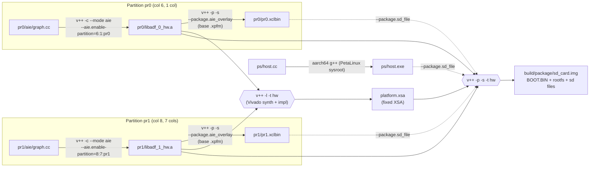

# Partition with nopl

Compile two independent partitions (`pr0` and `pr1`). The goal is to use these partitions with 2 different processes in different namespaces (containers).



- **libadf.a**: the compiled AIE graph for one partition (columns fixed at compile time).
- **xclbin**: an AIE-only runtime image for one partition. It's loaded by `host.exe`
  through `xrt::hw_context` and can be reloaded without rebooting.
- **platform.xsa**: the fixed platform (NoC, DDR, clocks, PL) that merges all partitions.
  Its PDI goes into `BOOT.BIN` and is loaded once, at boot.
- **Package**: needs the fixed XSA plus **every** libadf.a, in the **same order as the link**.
  The xclbins and `host.exe` are just files copied onto the SD card

The goal is to provide an abstraction of AIE partitions that can be used with DRA model like this:

```sh
# ResourceSlice: one device per static slot
- name: pr0
  attributes:
    aie.amd.com/startColumn: {int: 6}
    aie.amd.com/numColumns:  {int: 1}
    aie.amd.com/gmio:        {int: 2}
    aie.amd.com/plio:        {int: 0}
# ResourceClaim
selectors:
- cel: expression: device.attributes["aie.amd.com"].numColumns >= 1 &&
                   device.attributes["aie.amd.com"].gmio >= 2
```

## Building

Build the partitions with (use `TARGET=hw` to specify the real hardware platform):

```sh
# produce xclbin and libadf.a
make
````

Build the `xsa`:

```sh
# produce .xsa
make link
```

```sh
# produce BOOT.bin and sdcard files
make package
```


## Limitations

Partitions may not be relocatable.
